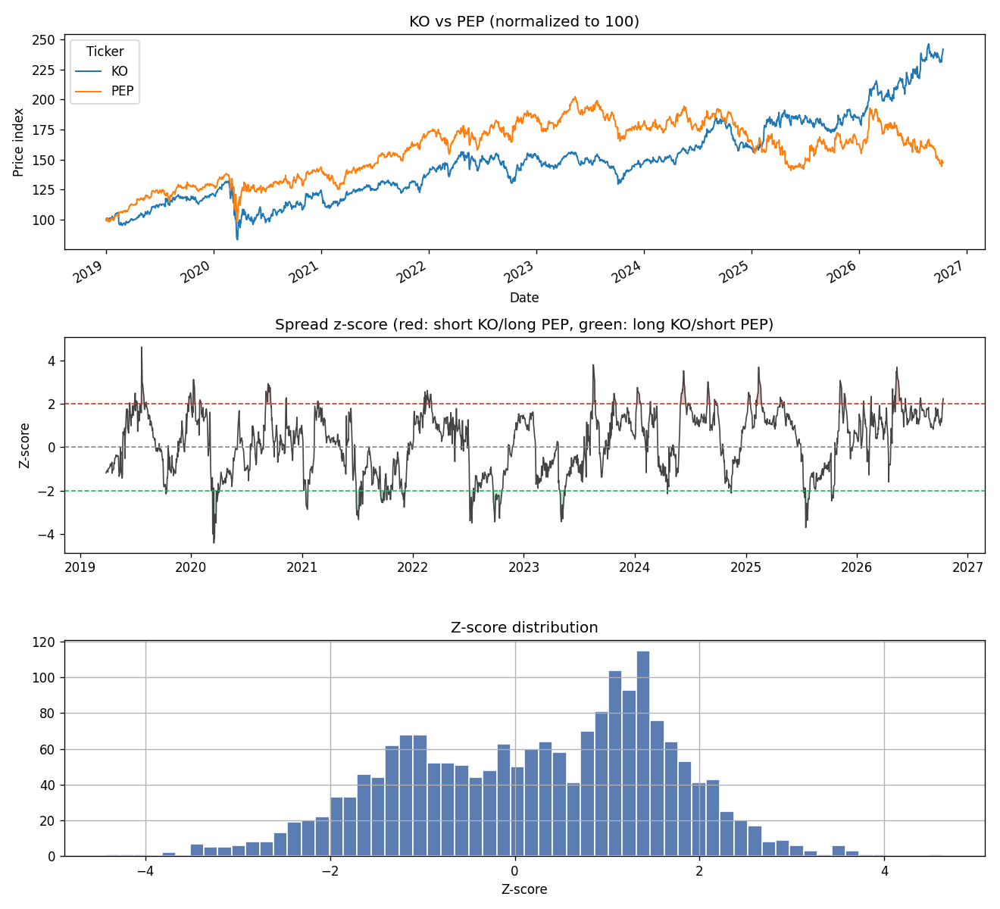

# Pairs Trading Research

A Python toolkit for testing whether two stocks have a statistically tradeable
relationship, built step by step, from cointegration tests up to a full
walk-forward backtest.

> **Research project, not financial advice.** Nothing here is a recommendation
> to trade.

## The idea

Pairs trading is a market-neutral strategy. You find two stocks whose prices
are linked, wait for the gap between them to stretch unusually wide, then go
long the laggard and short the leader. If the relationship holds, the gap
closes and you profit regardless of whether the overall market went up or down.

The hard part is the word *linked*. This project tests that claim rigorously
instead of eyeballing two lines on a chart.

## Key finding so far: correlation is not enough

Social media often pitches Coca-Cola vs. Pepsi as the textbook pair. The data
(2019–2026) disagrees:

| Pair | Correlation | Coint. p-value | Half-life (days) | Verdict |
|---|---:|---:|---:|---|
| KO / PEP | 0.60 | 1.000 | ∞ | Not cointegrated |
| V / MA | 0.99 | 0.050 | 45.8 | Borderline |
| HD / LOW | 0.97 | 0.073 | 62.5 | Not cointegrated |
| XOM / CVX | 0.98 | 0.045 | 73.8 | Cointegrated |



Since 2025, KO and PEP have split far apart (top panel), so a trader fading
the gap would have kept losing. But the **rolling z-score** (middle panel)
still oscillates neatly around zero, because its moving average follows the
drift. A rolling z-score will look mean-reverting on almost any pair. That's
why the cointegration test comes first, and why "trade it when it hits 2σ"
advice is dangerous on its own.

V/MA also shows the gap between correlation and cointegration: 0.99
correlation, yet only borderline evidence that the spread reverts.

## Method

1. **Hedge ratio:** OLS regression of one price on the other gives β, the
   number of shares of X to short per share of Y.
2. **Spread:** the regression residual, `Y − (α + βX)`.
3. **Cointegration:** Engle-Granger test (p < 0.05) plus an ADF test on the
   spread. Together they ask whether the spread is stationary.
4. **Half-life:** fit an Ornstein-Uhlenbeck model to the spread to estimate how
   many days a deviation takes to close halfway. Long half-lives tie up capital
   and expose you to regime changes.
5. **Z-score:** rolling standardization of the spread (past data only, no
   look-ahead), used for entry/exit signals.

## Quick start

```bash
python3 -m venv .venv
source .venv/bin/activate
pip install -r requirements.txt

python scripts/analyze_pair.py KO PEP
python scripts/analyze_pair.py XOM CVX --start 2015-01-01 --window 90

pytest
```

Charts are saved to `docs/images/`.

## Project structure

```
src/pairs/
  data.py     price download + CSV cache (yfinance)
  stats.py    hedge ratio, spread, cointegration, half-life, z-score
  plots.py    pair charts
scripts/
  analyze_pair.py   command-line analysis of one pair
tests/
  test_stats.py     tests on synthetic data with known answers
```

## Roadmap

- [x] **v1:** Single-pair analysis: cointegration, hedge ratio, half-life, z-score
- [ ] **v2:** Backtest entry/exit rules with transaction costs; Sharpe, drawdown, win rate
- [ ] **v3:** Scan and rank pairs across a sector
- [ ] **v4:** Walk-forward validation (fit on past window, trade the next one)
- [ ] **v5:** Kalman filter for a time-varying hedge ratio

## Limitations

- The full-sample hedge ratio and cointegration test use the whole period,
  which is look-ahead bias. v4 fixes this with walk-forward fitting.
- Engle-Granger results depend on which stock is Y and which is X.
- At 5% significance, testing many pairs will produce false positives
  (multiple-comparisons problem). Relevant once v3 scans many pairs.
- Free Yahoo Finance data. Not survivorship-bias free.
